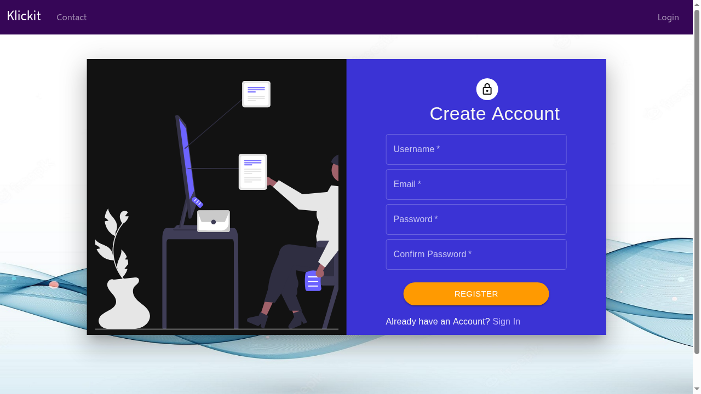

# Klickit

A responsive store front-end built with React and Material UI, with an admin area and real-time touches over Socket.IO. Users can browse products, register and log in, and contact the store; admins get a separate view.



**Live demo:** https://moazkandeel.github.io/Klickit/

## Features

- Product listing and home page with image sliders
- Auth pages (register / login) with Formik + Yup validation and protected routes
- Admin section
- Contact page with phone number input
- Toast notifications and scroll-to-top

## Tech stack

React 18, MUI 5, Zustand, React Query, React Router 6, Formik + Yup, Bootstrap 5, Express, Socket.IO

## Run locally

```bash
npm install
npm start
```

The app runs on http://localhost:3000.
